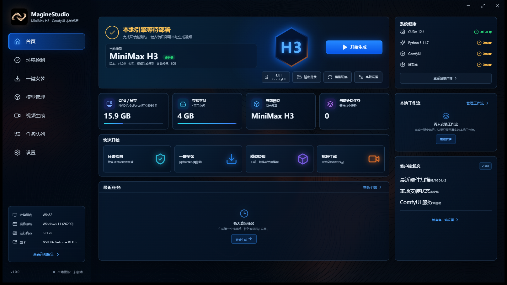

# MagineStudio


[](https://github.com/Magine1921/MagineStudio/actions/workflows/ci.yml)

MagineStudio 是一个面向 Windows 的本地视频生成桌面客户端。它负责检测硬件与运行环境、配置 ComfyUI 和 MiniMax H3 模型路径，并通过本机 ComfyUI API 提交、跟踪和预览视频生成任务。

> MagineStudio 是独立社区项目，并非 MiniMax 或 Comfy Org 的官方产品。应用源码使用 Apache-2.0；MiniMax H3 模型权重和 ComfyUI 分别遵循各自的独立许可证。



## 主要能力

- 扫描 Windows、CPU、内存、磁盘、NVIDIA GPU、显存、驱动与 CUDA 环境。
- 根据本机显存和内存给出保守的运行档位与生成参数建议。
- 检测现有 Python、Git、ComfyUI、模型文件和模型路径配置。
- 分别选择并持久化 ComfyUI、模型和视频输出目录。
- 下载、续传并校验官方 ComfyUI 运行环境和用户选择的模型文件。
- 生成或修复 `extra_model_paths.yaml`，支持模型与 ComfyUI 分盘存放。
- 启动、检查和停止仅监听 `127.0.0.1` 的本地 ComfyUI 服务。
- 通过 ComfyUI HTTP/WebSocket API 提交任务并显示实时进度、预计时长和最终结果。
- 根据已安装模型支持文生视频、图生视频、首尾帧和全模态参考工作流。
- 在板块切换后保留创作草稿和真实任务状态。

## 支持范围

当前一键部署和本地推理路径面向：

- Windows 10/11 x64；
- NVIDIA CUDA 显卡；
- MiniMax H3 的 ComfyUI 官方节点和工作流。

AMD、Intel GPU、Linux 和 macOS 尚未作为受支持的一键部署配置。硬件分档来自保守的社区经验，不代表 MiniMax 官方硬件认证。实际可用分辨率、时长和并发能力取决于显存、内存、模型精度及 ComfyUI 版本。

## 模型与许可证

模型权重不会提交到本仓库，也不会受到本项目 Apache-2.0 许可证的授权。安装前请阅读并接受模型发布者当前提供的许可证：

- [MiniMax H3 官方模型与许可证](https://huggingface.co/MiniMaxAI/MiniMax-H3)
- [ComfyUI 格式的 MiniMax H3 模型](https://huggingface.co/Comfy-Org/MiniMax-H3)
- [ComfyUI MiniMax H3 教程](https://docs.comfy.org/tutorials/video/minimax/minimax-h3)
- [ComfyUI 项目与 GPL-3.0 许可证](https://github.com/Comfy-Org/ComfyUI)

模型许可可能包含用途、地区、分发、内容安全或标识要求。用户有责任在下载、使用和分发前核对最新条款。更多说明见 [THIRD_PARTY_NOTICES.md](THIRD_PARTY_NOTICES.md)。

## 开发环境

需要安装：

- Node.js 24 或更高版本；
- Rust stable `x86_64-pc-windows-msvc`；
- Visual Studio C++ Build Tools；
- WebView2 Runtime。

安装依赖并启动桌面开发端：

```powershell
npm ci
npm run tauri dev
```

只预览前端界面：

```powershell
npm run dev
```

浏览器预览使用明确标注的模拟硬件数据，不会扫描本机、安装组件或提交真实生成任务。真实功能必须通过 Tauri 桌面开发端运行。

## 验证

```powershell
npm test
npm run build
cargo fmt --manifest-path src-tauri/Cargo.toml -- --check
cargo test --manifest-path src-tauri/Cargo.toml
cargo clippy --manifest-path src-tauri/Cargo.toml --all-targets -- -D warnings
cargo check --manifest-path src-tauri/Cargo.toml --release
```

涉及安装、路径、ComfyUI 通信或视频生成的改动，还应在真实 Windows + NVIDIA + ComfyUI 环境中完成端到端验证。

## 项目结构

```text
src/                         React 界面、状态和 Tauri API 调用
src-tauri/src/hardware.rs    本机硬件检测与能力分档
src-tauri/src/installer.rs   环境检测、下载、校验与路径配置
src-tauri/src/runtime.rs     ComfyUI 本地进程管理
src-tauri/src/comfy.rs       工作流构建、任务提交与结果解析
docs/工作原理与执行方案.md     架构、边界和实施方案
.github/workflows/ci.yml     GitHub Actions 自动验证
```

## 安全

请不要在 Issue、截图或日志中提交用户名、令牌、提示词、模型私有地址或完整本机路径。安全问题请按照 [SECURITY.md](SECURITY.md) 私下报告。

MagineStudio 仅管理自身创建的缓存目录，并默认让 ComfyUI 监听回环地址。安装第三方 ComfyUI 自定义节点等同于在本机执行第三方代码，不属于 MagineStudio 的信任边界。

## 参与贡献

贡献前请阅读 [CONTRIBUTING.md](CONTRIBUTING.md)。所有主动提交并被项目接纳的贡献默认依据 Apache License 2.0 提供。

## 许可证

源代码依据 [Apache License 2.0](LICENSE) 发布：

```text
Copyright 2026 Magine
```

Apache-2.0 不授予 MagineStudio 名称、Logo 或其他品牌标识的使用权，但允许为说明原始项目来源而进行合理引用。第三方组件和模型权重不包含在本许可证中。
